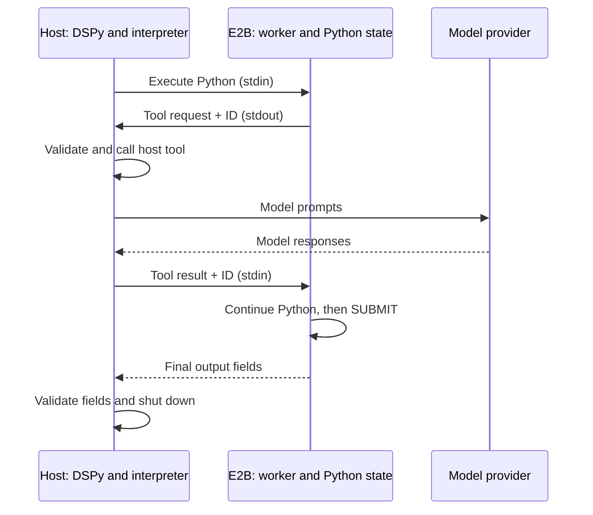

[DSPy RLM](https://dspy.ai/api/modules/RLM/) lets a model explore inputs with Python, call sub-models on selected passages, and submit a typed answer. The [E2B cookbook example](https://github.com/e2b-dev/e2b-cookbook/tree/main/examples/dspy-rlms-python) provides an `E2BInterpreter` for DSPy 3.4.0's native `interpreter_factory` interface.

## Why use E2B for DSPy RLMs

DSPy's default Python interpreter already isolates code in local Deno/Pyodide WASM and lets the model inspect inputs without putting them in the prompt. E2B supplies remote Linux with full CPython, including `sqlite3` and `subprocess`, plus an enforced execution deadline: if generated code loops forever, the adapter kills its sandbox. DSPy 3.4.0's default Python interpreter has no code-execution timeout. This example uses the network-off E2B base environment, without pandas/numpy or a custom template.

## Install the example

Use Python 3.10–3.14 and [uv](https://docs.astral.sh/uv/getting-started/installation/):

```bash
git clone https://github.com/e2b-dev/e2b-cookbook.git
cd e2b-cookbook/examples/dspy-rlms-python
uv sync --frozen
cp .env.example .env
```

Set these values in the ignored `.env`:

```bash
E2B_API_KEY=e2b_...
OPENAI_API_KEY=...
MODEL=openai/gpt-5.6-luna
```

The default model is [GPT-5.6 Luna](https://developers.openai.com/api/docs/models/gpt-5.6-luna). The LM settings are chosen for OpenAI reasoning models: `temperature=None` and `max_tokens=16000`. `MODEL` changes only the identifier; other models may need different LM parameters in `main.py`. Compatibility with other models is not established.

`E2BInterpreter` comes from this locally installed project, with DSPy pinned to 3.4.0 and core E2B 2.53.1 in its lockfile. It is not a native DSPy import or a separately published PyPI package. To use it elsewhere, install the local project with `pip install /path/to/e2b-cookbook/examples/dspy-rlms-python`.

Keys remain on your host. E2B receives generated code and selected inputs; the model provider receives prompts and passages sent to sub-queries. Pass only data those services may process. The sandbox itself has no outbound network access.

## Check persistent SQLite without a model

Save the following as `check_sqlite.py` in the example directory and run `uv run check_sqlite.py`. This calls E2B and needs only `E2B_API_KEY`, with no model request:

```python
from dotenv import load_dotenv
from dspy_e2b import E2BInterpreter

load_dotenv()
interpreter = E2BInterpreter()
try:
    interpreter.execute("import sqlite3; db = sqlite3.connect(':memory:')")
    interpreter.execute("db.execute('CREATE TABLE incidents(region TEXT)')")
    interpreter.execute("db.executemany('INSERT INTO incidents VALUES (?)', [('eu',), ('eu',), ('us',)])")
    counts = interpreter.execute("dict(db.execute('SELECT region, count(*) FROM incidents GROUP BY region'))")
    assert counts == {"eu": 2, "us": 1}
    print(counts)
finally:
    interpreter.shutdown()
```

The connection survives across execution steps. `shutdown()` deletes the owned sandbox, including its processes and files.

## Run the incident-analysis RLM

```bash
uv run main.py
```

This uses E2B and your model provider. `main.py` configures `dspy.LM`, loads the incident records, and uses this typed signature and interpreter factory:

```python
import dspy
from dspy_e2b import E2BInterpreter


class IncidentAnalysis(dspy.Signature):
    records: list[dict] = dspy.InputField()
    query: str = dspy.InputField()
    candidate_ids: list[str] = dspy.OutputField(desc="Exact SQL-filtered IDs, sorted")
    queue_incident_ids: list[str] = dspy.OutputField(desc="IDs classified as queue buildup, sorted")
    counts_by_region: dict[str, int] = dspy.OutputField(desc="SQL counts for queue_incident_ids")
    summary: str = dspy.OutputField(desc="Short explanation grounded in the selected records")


def interpreter_factory():
    return E2BInterpreter(execution_timeout=120, sandbox_timeout=600)


interpreter_factory.execution_instructions = E2BInterpreter.execution_instructions

rlm = dspy.RLM(
    IncidentAnalysis,
    interpreter_factory=interpreter_factory,
    max_iters=6,
    max_llm_calls=4,
    max_output_chars=4000,
)
```

`main.py` then calls the RLM with the records and query. Each factory call returns a fresh interpreter; DSPy supplies its tools and output-field metadata and calls `shutdown()` in `finally` when the invocation ends.

## How the RLM loop works

The action model writes Python to select resolved, high-severity inference incidents in SQLite, classify candidate passages with sub-queries, and compute region counts. Execution output returns to DSPy's trajectory and informs the next action. Imports, generated variables and the SQLite connection survive between steps; the supplied input variables are freshly assigned each step.

Inside the sandbox, `llm_query` and `llm_query_batched` are Python wrappers for registered host callables. A wrapper sends a JSON tool request with an ID through the worker's stdout and waits for a matching reply. The host interpreter validates the request and runs the callable; for built-in model tools, DSPy sends the provider requests from the host. The reply returns through worker stdin, and generated Python continues with the returned value.

The successful tool-call and submission path is:



The generated code eventually calls `SUBMIT` with computed fields. The worker ends that code block and returns a final-output message; DSPy parses and validates the fields against `IncidentAnalysis` before returning a prediction. A validation error can become feedback for another step. The interpreter protocol carries both execution and tool messages, so guest networking and provider credentials are unnecessary. Host tools are still capabilities: each callable must validate its arguments, restrict host operations and use its own deadlines.

## Explore a larger input

The eight-record seed is a small first-run check. To explore a larger input, generate 50,000 low-severity background records locally from that seed:

```bash
uv run main.py --background-records 50000
```

No downloads are needed. The four high-severity candidates stay the same, so the sub-query budget stays at four. RLM inspects the data through generated code instead of putting the entire dataset in its action prompt. This mode still calls E2B and your model provider. It exercises exploration of a larger input with the same four candidates; it does not establish arbitrary long-context quality or provider superiority.

## Inspect the trajectory and observed results

`result.json` contains `answer`, `fixture_assessment` and the native trajectory. Inspect the generated code, reasoning and execution output to see whether the model used SQLite and sub-queries.

The seed has four SQL candidates and three labelled queue incidents (`INC-001`, `INC-004`, `INC-006`), with counts `{"eu": 2, "us": 1}`. `exact_ids_and_counts` checks the candidate filter, submitted-ID structure and counts for those submitted IDs. `fixture_semantic_labels_match` separately reports agreement with the fixture's queue labels. A structural check can pass even when semantic labels differ; neither check establishes model reliability. If a deterministic check fails, the run raises an error but still saves and prints the answer, trajectory and assessment error.

With `openai/gpt-5.6-luna`, one run of each configuration produced matching candidate IDs, region counts and fixture semantic labels:

| Input | Elapsed time | RLM steps | Observed behavior |
| --- | --- | --- | --- |
| Eight-record seed | 19 s | 3 | Inspect records; filter in SQLite and call `llm_query_batched` once; aggregate in SQL and SUBMIT from variables. |
| Seed plus 50,000 background records | 30 s | 5 | Inspect type/count/first/last record; filter four candidates in SQLite; call `llm_query_batched` once; aggregate in SQL; SUBMIT from variables. |

Both runs used Python 3.14, DSPy 3.4.0, E2B 2.53.1, `temperature=None`, `max_tokens=16000`, and a 20-second per-request timeout. Each configuration was run once; these results do not estimate reliability or guarantee timings.

Excerpt from the larger-input trajectory, with the SQLite connection and per-candidate prompts prepared in earlier code:

```python
selected = conn.execute("""
    SELECT id, region, summary
    FROM incidents
    WHERE service = 'inference'
      AND status = 'resolved'
      AND severity = 'high'
    ORDER BY rowid
""").fetchall()

print("selected count:", len(selected))
print("selected IDs:", [x[0] for x in selected])

# After building one prompt per selected record:
judgments = llm_query_batched(prompts)
```

The filter printed:

```text
selected count: 4
selected IDs: ['INC-001', 'INC-002', 'INC-004', 'INC-006']
```

The batched answers classified `INC-002` as NO because model loading failed before requests could enter the scheduler. The final answer from that run was:

```json
{
  "candidate_ids": [
    "INC-001",
    "INC-002",
    "INC-004",
    "INC-006"
  ],
  "queue_incident_ids": [
    "INC-001",
    "INC-004",
    "INC-006"
  ],
  "counts_by_region": {
    "eu": 2,
    "us": 1
  },
  "summary": "Four resolved high-severity inference incidents were candidates. Three involved actual request queue buildup (INC-001, INC-004, INC-006); INC-002 did not because requests could not enter the scheduler. Queue incidents by region: eu=2, us=1."
}
```

### Request and execution budgets

The example caps action iterations at six and sub-queries at four. DSPy may make one additional extraction request if the model does not submit. Provider calls have a 20-second timeout, no SDK retries or adapter fallback retries and a 16,000 completion-token budget, including reasoning tokens. The example factory gives each code execution a 120-second deadline, including host-tool waiting; the adapter default remains 60 seconds. Prefer `llm_query_batched` for independent prompts, and use computed variables in `SUBMIT`. These instructions do not guarantee model compliance.

## Lifecycle and limits

### State and invocation isolation

DSPy uses one owned sandbox per invocation and calls `shutdown()` in `finally`. Every factory call must return a new interpreter. Imports, generated variables and files persist within that invocation; inputs are freshly assigned each step. Concurrent invocations use separate sandboxes. Manual callers use `try/finally` as in the SQLite check.

### Deadlines and execution failures

The execution deadline includes host-tool waiting. The default 600-second sandbox TTL is refreshed at each execution boundary, and model thinking time between executions counts toward it. Expiry fails explicitly, without recreation or replay. Syntax and generated-code errors are recoverable so RLM can try another step; setup, transport, worker death and deadline errors are terminal and trigger sandbox deletion. Oversized printed output is truncated. An oversized ordinary expression result is recoverable, so Python state remains available to inspect a smaller value. Oversized tool arguments are rejected before invoking the host callable and produce recoverable code feedback. Oversized structured `SUBMIT` output is terminal and ends the session; final fields are never truncated. Protocol and input limits remain enforced.

### Host tools and credentials

Tools and provider keys remain on the host. Killing the sandbox cannot stop an already running host callable or provider request; set their deadlines independently. Generated code and children receive EOF on standard input; worker protocol input uses a separate descriptor. This example exposes no guest network or package installation, and uses no pandas/numpy or custom template.

### Cleanup and diagnostics

The `dspy_e2b` INFO logger records `sandbox_id` and `dspy_session`. Cleanup errors carry those IDs plus original-failure/submission diagnostics. After a host crash, use the exact session tag to reconcile resources. A TTL is a backstop, not confirmation of deletion.

See the [cookbook README](https://github.com/e2b-dev/e2b-cookbook/blob/main/examples/dspy-rlms-python/README.md) for input/frame limits, host-tool concurrency, async behavior, cleanup commands and troubleshooting.
