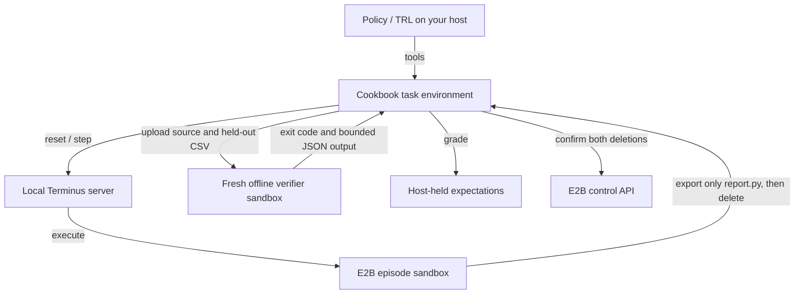

[OpenEnv](https://github.com/huggingface/OpenEnv) gives a model tools, observations and rewards for reinforcement learning and agent evaluation. Its [Terminus environment](https://github.com/huggingface/OpenEnv/tree/v0.8.0/envs/terminus_env) runs terminal commands in E2B, so a policy can inspect files, execute a program, edit it and check its work over several turns.

## Where OpenEnv and E2B fit

E2B keeps executable episode code isolated from your trainer host and preserves files between steps. Reset starts a fresh sandbox for the next completion. The OpenEnv server, model inference and training run on your own compute; this Terminus path works with a local server and requires no Docker.



Terminus supplies the native reset/step protocol and policy workspace. The cookbook's `ReportEpisode` manages task data, deadlines, submission and cleanup. It creates the verifier through the E2B SDK and compares the result with expectations on the host. TRL supplies the model's tool loop and optimizer when you enable training.

## Run your first repair episode

The example starts from a Python CSV report that overwrites repeated regions instead of adding their sales. One episode submits that bug and scores zero. A fresh episode inspects the files, repairs the program, reruns it and scores one.

Requires Python 3.12 or 3.13, [uv](https://docs.astral.sh/uv/getting-started/installation/), Git and an [E2B API key](https://console.e2b.dev). The demo creates four short-lived sandboxes sequentially: a policy workspace and a verifier for each episode. It consumes usage credits; no model provider key or GPU is needed.

### Start the local server

Get the [OpenEnv Terminus example](https://github.com/e2b-dev/e2b-cookbook/tree/main/examples/openenv-terminus-python) and install its pinned dependencies:

```bash
git clone https://github.com/e2b-dev/e2b-cookbook.git
cd e2b-cookbook/examples/openenv-terminus-python
uv sync --frozen
cp .env.example .env
```

Set `E2B_API_KEY` in the ignored host `.env`. Start the server from that directory:

```bash
uv run --frozen uvicorn server:app --host 127.0.0.1 --port 8010
```

### Run the demo and inspect the result

In a second terminal, from the same directory:

```bash
uv run --frozen main.py
```

Expected repaired output on the visible CSV:

```json
{"east": 15, "west": 7}
```

The buggy output is `{"east": 5, "west": 7}`. The receipt contains rewards `[0.0, 1.0]`, two policy IDs, two verifier IDs, operation timings and confirmed cleanup. This scripted result checks execution and grading. Stop the local server with Ctrl-C after the clients finish.

## Follow an episode from reset to reward

### Inspect and edit persistent files

`reset()` installs the buggy `report.py` and visible `sales.csv` in a new policy sandbox. `terminal(command)` sends each action through native `step(CallToolAction(...))` and returns output to the policy. The same files are available for inspection, execution and repair across those calls.

### Submit the source to a fresh verifier

`submit()` exports only `report.py`, confirms deletion of the policy sandbox, then creates a fresh sandbox from the same template with outbound access disabled. It uploads the source and a separate CSV. Background processes, companion files and modified binaries from the policy workspace are excluded from that transfer.

### Grade on the host and finish cleanup

The verifier runs the fixed Python command under a timeout. The host requires exit code zero and JSON containing exactly the expected integer totals. Submission confirms verifier deletion before committing the score; `get_reward()` returns that committed result. Without submission, reward collection checks the policy sandbox before accepting zero and deletes it.

| Outcome | Task score |
| --- | --- |
| Buggy report or visible-answer hardcode fails the separate CSV | `0.0` |
| Correct aggregation produces the separate input's totals | `1.0` |
| Healthy episode ends without submission | `0.0` |
| Submitted code exits non-zero, times out or produces invalid output | `0.0` |
| Policy window exhausted in a healthy sandbox | Zero after confirmed cleanup; continue training |
| Resource loss, transport failure, global deadline or unresolved cleanup | Abort without scoring |

<Warning>
OpenEnv 0.8.0 accepts a policy-writable `reward.txt` value. This cookbook ignores it and grades on the host. The submitted candidate remains untrusted code in the fresh verifier. Both fixed fixtures are public, so this task check does not establish generalization or a complete adversarial grading boundary.
</Warning>

## Use the Python bridge

With the server running, execute this from the example directory:

```python
import shlex

from dotenv import load_dotenv
from episode import BUGGY, PROGRAM, ReportEpisode

load_dotenv()
episode = ReportEpisode()
try:
    print(episode.reset())
    print(episode.terminal(f"cat {PROGRAM}; python3 -B {PROGRAM}"))
    fixed = BUGGY.replace(
        '= int(row["amount"])',
        '= totals.get(row["region"], 0) + int(row["amount"])',
    )
    episode.terminal(f"printf %s {shlex.quote(fixed)} > {PROGRAM}")
    print(episode.submit())   # Verify the source on a separate CSV, then delete both sandboxes.
    print(episode.get_reward())  # 1.0; both sandboxes are already confirmed absent.
finally:
    episode._close()
```

`terminal` returns observations, `submit` verifies and cleans up, and `get_reward` returns the score. The `finally` also protects operations that fail before reward collection. After submission, further tool calls cannot mutate the episode.

## Adapt the task

The cookbook's [task.json](https://github.com/e2b-dev/e2b-cookbook/blob/main/examples/openenv-terminus-python/task.json) contains `id`, visible CSV `input`, integer `expected` totals, a `prompt`, and a `verification` pair with a separate input and expected totals. Setup uploads the visible input and buggy program; verification data stays on the host until submission.

Change both input/expectation pairs and the prompt together. For a different defect, update the starter in `episode.py`, the scripted repair in `main.py` and the focused tests. Keep grading expectations in trusted orchestration.

For TRL, the dataset columns are `prompt` (chat messages) and `task` (trusted reset data serialized with `json.dumps`). Reset decodes the JSON; this preserves each task's expectation keys when Arrow stores rows with different regions. Direct Python callers can still pass a task dictionary. Only `terminal(command)` and `submit()` are model tools; reset, expected answers, sandbox identity and cleanup remain orchestration controls.

## Connect the environment to TRL

### Choose a tool-capable model

Keep the local server running. Set `MODEL_PATH` to a Transformers checkpoint or model ID whose chat template and response parser support tool calls such as `terminal(command="...")`. Install the training extra and run:

```bash
uv sync --frozen --extra training
uv run --frozen --extra training train.py --model "$MODEL_PATH"
```

The example leaves model choice to you. `--cpu` supports local wiring checks; practical training requirements depend on your checkpoint and compute. Pretrained task success, GPU requirements and learning improvement have not been measured by this example.

### Let the native tool loop collect the rollout

`train.py` passes a factory to TRL 1.14.2's experimental `GRPOTrainer(environment_factory=...)`. TRL discovers the typed `terminal` and `submit` methods, calls `reset(task=...)` for each completion, appends tool observations and calls `get_reward()` when collecting scores. It owns generation, token masks and the GRPO loss; Transformers >=5.2 supplies tool-call parsing.

TRL pools Python environment objects. Constructing `ReportEpisode` allocates nothing, and each reset replaces its sandbox. Batch startup and tool calls can run serially. Submission blocks further mutations, while TRL's completion/token limits control when generation ends. The training run's `finally` closes every environment again.

### Understand the configuration and artifacts

The defaults request two completions per prompt, a two-completion batch, up to 512 completion tokens, a learning rate of `1e-6` and one optimizer step. `--max-steps` changes the step count; `--output-dir` defaults to `training-output`. CPU mode disables BF16; the normal path requests BF16.

On successful training, the script saves the model under `training-output/checkpoint` and prints JSON with operation traces and cleanup entries. This is a model save; the script does not save optimizer state for resuming training. External experiment reporting is disabled. Full generated-conversation logging is not enabled by default, and a one-step run may finish before TRL's usual metric logging interval.

### Check tool calls and reward signal

Use the operation trace to confirm the policy executed tools and submitted. When reading TRL metrics, distinguish reward quality from tool parsing and optimizer activity:

| Signal | What it tells you |
| --- | --- |
| `reward` | Mean task score for the scored completions |
| `tools/call_frequency`, `tools/failure_frequency` | Calls per completion and fraction of calls that raised; a completed shell error can still be a normal observation |
| `frac_reward_zero_std` | Fraction of groups with identical rewards; those groups supply no reward difference for GRPO |
| `train_loss` | Optimization summary; zero can occur when every completion receives the same reward |

An initial run can finish with all rewards zero and `train_loss=0`. Check tool parsing and submission first, then inspect candidate failures and adjust tasks or prompting until some completions succeed and others fail before measuring learning. TRL can catch a tool exception and show it to the model; the bridge remembers infrastructure failures and raises again at reward collection to keep them out of training data.

For a model comparison, evaluate the starting and saved models with the same tasks, verification inputs, prompts, sampling settings, token/tool budgets and sandbox resources. Report task scores, infrastructure failures, latency and cost separately. The scripted demo and one optimizer step establish wiring; a learning claim needs a separate evaluation on varied tasks and held-out data.

## Lifecycle and failures

### State and reset

Files persist within an episode. Each terminal command starts a fresh shell, so use absolute paths rather than relying on a previous `cd` or export. Reset replaces the whole sandbox, including background processes. The sandbox connection is attached before the policy runs, and submission never reconnects to or resumes that sandbox.

### Timeout budgets and cancellation

The policy window starts after reset setup finishes. When it expires, the next tool or reward boundary checks sandbox health, confirms deletion and commits zero; subsequent commands are blocked. A timely submission stops policy work, and export/verification use the global and operation budgets. Infrastructure or cleanup failures remain fatal even when the policy window has expired. These checks do not interrupt model generation on the host; the trainer must enforce its own generation timeout.

| Budget | Value | Purpose |
| --- | --- | --- |
| Native policy lifetime, then host extension | 300 s, then 600 s | Remote backstop, extended after the policy ID arrives |
| Policy window after ready reset | 120 s | Batch waiting, generation and terminal work until submission |
| Global episode deadline | 600 s | Reset through verification and cleanup; exhaustion remains fatal |
| Sandbox-side command limit | 10 s | Bound an ordinary shell or report execution |
| Native client message limit | 25 s | Wait for an OpenEnv response |
| Verifier lifetime / SDK command response | 120 s / 20 s | Bound the extra resource and command response |
| Artifact/output transfer deadline | 10 s | Bound each file transfer, capped at 64 KiB |

A returned shell error or timeout lets the policy inspect the result and correct its program. A lost response or local cancellation leaves remote execution uncertain: the recipe aborts scoring, removes its owned resources and avoids replaying the step. Detached processes can outlive a shell command, so cleanup removes the whole sandbox. If reset loses an allocation response before an ID arrives, the native lifetime bounds that unknown resource.

### Cleanup and resource reconciliation

The OpenEnv 0.8.0 server can suppress teardown failures. The recipe therefore deletes and checks every known owned ID, retries deletion for those IDs and reports unresolved cleanup. A committed score is readable after deletion. For an unresolved ID, check that owned resource in the [E2B console](https://console.e2b.dev) before rerunning. An abrupt host kill can require manual reconciliation.

Keep the key on the host. The server binds to loopback; the policy sandbox retains native template networking, and the verifier has outbound access disabled. The cookbook includes failure diagnostics and a troubleshooting table.

## Scale and cost

With serial startup, the first sandbox waits roughly `(batch_size - 1) * reset_time` before generation. Budget its lifetime and both local windows for that wait, generation, tool calls, verification and cleanup, with margin for rate-limit delays. Measure those phases separately on your workload; the dated smoke sample is in the cookbook.

[Billing and limits](/billing) lists project-wide creation and concurrency limits. The server's two-session cap and allocation pacing apply to one process. Each submitted rollout uses two allocations; an episode without submission uses one. Coordinate additional workers against the same project budget. The E2B SDK honors `Retry-After` for API 429 responses; retrying an uncertain episode can duplicate work.

Use actual CPU/RAM sizes and full running lifetime with [current pricing](https://e2b.dev/pricing): sum `running_seconds * (vCPUs * CPU_rate + GiB * memory_rate)` across policy and verifier resources. Resources are billed while waiting for the model. Cleanup confirmation gives a conservative lifetime estimate, and completed resources close before optimizer time. Add model/GPU and subscription costs separately.

## Other rollout and training paths

Use Terminus for terminal steps inside one code-repair episode. [NeMo Gym](/agents/nemo-gym) offers a provider configuration for its own task harnesses. [OpenEnv Harbor](https://github.com/huggingface/OpenEnv/tree/v0.8.0/src/openenv/harbor) drives a whole coding-agent rollout with separate task/template and token-capture prerequisites. Native Jupyter shares mutable policy-kernel state, so keep task verification outside that kernel.

For managed compute, see the [Fireworks Training API RL](https://docs.fireworks.ai/fine-tuning/training-api/cookbook/rl) and [agentic RL](https://docs.fireworks.ai/fine-tuning/training-api/cookbook/agentic-rl) recipes. That training path requires an adapter associating generated tokens with their probabilities and tool-output masks; it is a separate integration.
