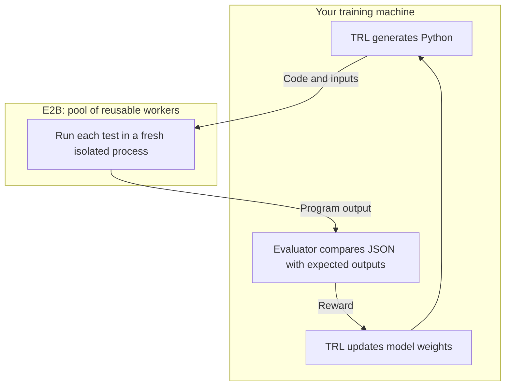

[TRL](https://huggingface.co/docs/trl/v1.14.2/grpo_trainer) is Hugging Face's library for training language models. With GRPO, a model generates multiple solutions to a task and learns from their relative rewards. E2B can execute the generated code in isolated sandboxes, while your evaluator checks its output and returns a reward to TRL.

The [E2B cookbook example](https://github.com/e2b-dev/e2b-cookbook/tree/main/examples/trl-grpo-python) trains a model to process JSON API-usage records: sum tokens, count requests and filter successful requests per customer. Start by evaluating fixed solutions without a GPU or model download, then use the same reward callback for training.

Use this workflow when you can check correctness with test inputs and trusted expected outputs, such as extracting or transforming structured data. Generated programs run remotely instead of on the machine holding your training data and model credentials. You do not need to install a code-execution service on the GPU host; that host calls E2B through the Python SDK. Remote execution adds sandbox creation and network overhead, so measure the reward stage before scaling a training job.

## Where E2B fits



Model generation and weight updates stay on your training machine. E2B receives candidate code and test inputs; expected outputs and reward calculation stay outside the candidate sandbox. Each candidate runs on a *worker*: an E2B sandbox that the pool keeps between callbacks. Every test still starts in a fresh process.

## Get your first code reward

The commands use Python 3.12; the package supports Python 3.11–3.13. You also need [uv](https://docs.astral.sh/uv/getting-started/installation/) and an [E2B API key](/api-key). This reward smoke test installs only the evaluator dependencies and uses E2B sandbox resources.

```bash
git clone https://github.com/e2b-dev/e2b-cookbook.git
cd e2b-cookbook/examples/trl-grpo-python
uv sync --locked --python 3.12 --no-dev
cp .env.example .env
```

Set `E2B_API_KEY` in `.env`, then run:

```bash
uv run --locked --no-dev --env-file .env python reward_smoke.py
```

The evaluator runs fixed programs against three test cases and returns:

```json
{
  "correct": 1.0,
  "wrong": 0.0,
  "partial": 0.3333333333333333,
  "syntax_error": 0.0,
  "timeout": 0.0
}
```

A correct program passes every case. The partial program prints `{}`, so it passes only the empty-input case. Expected results are compared as complete JSON values; a matching prefix or candidate-supplied score is not accepted. Invalid syntax needs no sandbox. The command also verifies that no running or paused sandbox remains for its run.

## Follow one solution from code to reward

The first task asks the model to sum `tokens` for each `customer`. For example, the evaluator writes this input to the candidate's stdin:

```json
[
  {"customer": "acme", "tokens": 12},
  {"customer": "beta", "tokens": 3},
  {"customer": "acme", "tokens": 8}
]
```

The expected output is `{"acme": 20, "beta": 3}`. A complete solution looks like this; the model must return it inside a fenced Python code block:

```python
import json
import sys

totals = {}
for record in json.load(sys.stdin):
    customer = record["customer"]
    totals[customer] = totals.get(customer, 0) + record["tokens"]
print(json.dumps(totals))
```

The reward callback extracts the code block and checks Python syntax on the host. For valid code, it borrows a pool worker, writes the program and runs each input in a fresh isolated process. The host parses each output as JSON and compares it with the trusted expectation. The candidate receives inputs, but neither expected outputs nor a grading script.

| Test case | Expected output | Correct program | `print('{}')` |
| --- | --- | --- | --- |
| Empty input | `{}` | Pass | Pass |
| Repeated customers | `{"acme": 20, "beta": 3}` | Pass | Fail |
| Zero and large token totals | `{"zero": 0, "large": 100000}` | Pass | Fail |
| Reward: passed cases / all cases | — | `3 / 3 = 1.0` | `1 / 3` |

This score measures program behavior rather than similarity to a reference implementation. GRPO compares rewards among solutions generated for the same prompt. If all solutions receive the same reward, there is no relative reward difference to learn from; inspect task difficulty, output formatting and completion length before increasing the training duration.

## Connect the reward to TRL

Connecting the reward to a training run takes three steps: check the baseline reward for your model, train with the same model, then compare held-out results before and after training.

### Check baseline rewards

Choose an instruction-tuned coding model with a suitable chat template and enough GPU memory for training. Set `TRAIN_MODEL` in your shell to its Hugging Face model ID or local directory. The example has no default model: an untuned sample of `Qwen/Qwen2.5-0.5B-Instruct` gave zero reward for all 24 solutions. Check the reward signal for your chosen model before extending a run.

On your training machine, install the training extra and check the baseline first:

```bash
uv sync --locked --python 3.12 --extra training --no-dev
uv run --locked --extra training --no-dev --env-file .env python train.py \
  --model "$TRAIN_MODEL" --baseline-only
```

`--baseline-only` samples solutions for the training and held-out tasks, prints example completions and writes `training_results/baseline.json`. It does not update model weights or save a checkpoint. Inspect `baseline.train_tasks.eval_reward`, `baseline.held_out.eval_reward` and their `eval_frac_reward_zero_std` metrics before starting training. The mean reward is defined in [Interpret held-out evaluation](#interpret-held-out-evaluation). Unlike the fixed-program smoke, it uses your model compute and E2B resources.

Look for differing rewards among solutions to the same prompt. All-zero or all-one groups provide no relative learning signal, and identical partial scores also give none. Inspect the printed code and review model capability, prompt/schema and completion length before extending a job.

### Run training

When the baseline is useful, train with the same model:

```bash
uv run --locked --extra training --no-dev --env-file .env python train.py \
  --model "$TRAIN_MODEL"
```

### Task schema and reward interface

The script passes its async `pool.code_reward` to `GRPOTrainer` as `reward_funcs`. TRL supplies the dataset's `test_cases` column with each batch of completions and expects one score per completion, in order. This uses TRL's native custom reward interface; no E2B trainer package or sync/async bridge is needed.

The trainer connection in `train.py` is shown below. This is an excerpt from the complete script: `args` comes from its command-line options, and `config` is the `GRPOConfig` built there.

```python
import asyncio

from datasets import Dataset
from trl import GRPOTrainer

from rewards import RewardPool
from tasks import EVAL_TASKS, TRAIN_TASKS

pool = RewardPool(args.sandbox_workers, args.create_interval)
try:
    trainer = GRPOTrainer(
        model=args.model,
        args=config,
        reward_funcs=pool.code_reward,
        train_dataset=Dataset.from_list(TRAIN_TASKS),
        eval_dataset=Dataset.from_list(EVAL_TASKS),
    )
    trainer.train()
finally:
    asyncio.run(pool.close())
```

Each dataset row contains a conversational `prompt` and a `test_cases` list. The callback has the signature `async def code_reward(completions, test_cases, **kwargs)`: TRL aligns each completion with its cases, and `**kwargs` accepts the other trainer fields. The callback preserves that order even when sandbox evaluations finish in a different order. See [TRL's custom reward interface](https://huggingface.co/docs/trl/v1.14.2/grpo_trainer#using-a-custom-reward-function) for the framework contract.

| Dataset column | Shape | Consumer |
| --- | --- | --- |
| `task_id` | String identifying the task. | Task organization. |
| `prompt` | List of messages, each with string `role` and `content`. | Model generation. |
| `test_cases` | List of objects with JSON strings `input` and `output`. | Host reward callback; `input` is stdin and `output` is the trusted expectation. |

The callback returns a list of numeric rewards in `[0, 1]`, one per completion. Keeping each case's JSON as a string lets `Dataset.from_list` load records with different customer names without changing its column schema.

### Training configuration

The configuration uses your chosen model, two generations per prompt and eight training steps on a CUDA GPU. Model weights download to your machine. E2B supplies code execution, not the training GPU; no model-provider API key or vLLM service is required. The lockfile pins the example's dependencies, including TRL 1.14.2.

| Setting | Default | What it controls |
| --- | --- | --- |
| `--model` | Required | Model on your host, with a chat template and useful baseline rewards for these tasks. |
| `--baseline-only` | Off | Evaluate both task splits without updating weights. |
| `num_generations` in `train.py` | `2` | Solutions sampled per prompt for relative rewards. Keep generation batch sizes compatible with TRL's grouping requirements. |
| `--max-steps` | `8` | Training updates. This is a short workflow example, not a guaranteed convergence target. |
| `--max-completion-length` | `256` | Maximum generated tokens. Too short a budget can truncate the program or its closing code fence. |
| `--sandbox-workers` | `2` | Persistent workers, each evaluating one candidate at a time. This does not set GPU batch size. |
| `--create-interval` | `1.0 s` | Creation pacing. Use at least 1 second on Hobby or 0.2 seconds on Pro, leaving capacity for other clients. |
| Process deadline / worker TTL | `2 s` / `600 s` | Per-test execution limit; worker TTL is renewed every 200 seconds while the pool lives. |

Change CLI settings with `train.py --model ... --max-steps ... --max-completion-length ...`; change generation counts and batch settings together in `train.py`. The default uses BF16 on supported CUDA devices and otherwise FP32, with gradient checkpointing and no vLLM requirement.

<Note>
The reward smoke test verifies E2B execution and grading. The short training configuration is a starting point for your experiment; GPU memory and learning results depend on the model, generation settings and tasks. Inspect the reward signal before extending a run. The cookbook includes a slower CPU diagnostic for the training and checkpoint path.
</Note>

### Interpret held-out evaluation

The run saves model weights and tokenizer under `training_results/checkpoint/` and metrics in `training_results/metrics.json`. It evaluates separate tasks before and after training. Compare their mean rewards to check whether fitting the training tasks transfers to these held-out tasks.

In `metrics.json`, `before.eval_reward` and `after.eval_reward` are mean test-pass fractions over sampled completions. A mean reward of `0.5` does not mean half the programs are entirely correct: partial solutions contribute too. Compare the same held-out tasks and generation settings before and after training, and repeat measurements before drawing conclusions from a small improvement. `history` contains step-level training logs; a rising training reward can reflect fitting the training tasks rather than improvement on unseen tasks.

The held-out prompts in this example ask for input-token totals and error counts, rather than repeating the training instructions. For your own experiment, keep evaluation prompts and cases outside the training dataset.

Also inspect `frac_reward_zero_std` in the training entries of `history`. It is the fraction of prompt groups whose sampled solutions all receive the same reward. A value near `1.0` means those groups provide no relative reward signal. If rewards are all zero, inspect a generated program for missing fields, incomplete code or a task beyond the model's capability. If rewards are all one, try harder cases. More training steps alone do not fix either problem.

## Adapt the task

Edit `tasks.py` to define your instruction, JSON inputs and expected outputs. For example, this defines an output-token aggregation task using the existing helpers:

```python
from tasks import case, task

new_task = task(
    "output-tokens",
    'Sum the integer "output_tokens" field per customer. '
    'Do not add the integer "input_tokens" field.',
    [
        case([], {}),
        case(
            [
                {"customer": "acme", "input_tokens": 50, "output_tokens": 4},
                {"customer": "acme", "input_tokens": 10, "output_tokens": 6},
                {"customer": "beta", "input_tokens": 20, "output_tokens": 0},
            ],
            {"acme": 10, "beta": 0},
        ),
    ],
)
```

Add the `task(...)` call to `TRAIN_TASKS` in `tasks.py`. The import line is only needed when the snippet runs as a separate file. Keep different evaluation prompts and cases in `EVAL_TASKS`. `case(...)` serializes inputs and outputs as JSON strings, keeping the dataset schema stable as customer names change.

The task helper already defines `customer` as a string in the prompt. This instruction adds `output_tokens` and `input_tokens` as integers. Name any additional input fields and their types in the instruction: the model sees only the prompt, not the test cases, so it must not have to guess field names.

Validate your cases with a known correct solution before training. To check the changed first task with `reward_smoke.py`, update its fixed candidate programs and expected scores together. Include empty input, repeated customers and values that expose shortcuts; the example above makes summing `input_tokens` visibly incorrect. If you change the stdin/stdout format, update `rewards.py` as well as the prompt and cases.

## Execution and failure behavior

### Sandbox pool and concurrency

With six valid completions and two workers, the pool evaluates candidates in waves and keeps the same workers for the next callback. This avoids creating six separate sandboxes and repeating creation on subsequent steps. Each candidate borrows one worker exclusively; extra candidates wait for a free worker. Pool size is separate from GPU batch size, and one pool serves one single-process trainer; distributed training is outside this recipe.

### Isolation and timeouts

The pool reuses workers across callbacks. Each test starts a fresh unprivileged Python runtime in private Linux mount/PID/network/IPC namespaces. Worker files are read-only; writable temporary directories and descendant processes disappear after the case. Test cases and candidates do not share writable state.

A two-second remote limit applies to each test. A trusted supervisor runs all cases in one SDK command with a deadline of `2 × case count + 10` seconds. Output exceeding 64 KiB fails grading.

The key and expected outputs stay on the host. Workers use secured access, disabled outbound internet and a fresh network namespace per test. The task needs only Python's standard library. See [internet access](/network/internet-access).

Every new worker first runs a preflight check of its isolation setup on the default template. The cookbook relies on Linux `unshare`, mount namespaces, `setpriv`, Python 3 and GNU `timeout`; unsupported templates fail rather than silently weaken isolation. This example is not a formally audited adversarial grading platform. Validate any changes to its template or execution boundaries.

### Failures and retries

Wrong output and candidate runtime failures score zero. Recoverable transport, unavailable-service, rate-limit or lost-worker errors get one evaluation retry on a replacement worker; worker creation gets up to two attempts. Candidate errors are not retried. Authentication/configuration, failed isolation setup, exhausted retries and unresolved cleanup abort the run instead of becoming false learning signals.

### Cleanup and cancellation

The trainer owns the pool and closes it in `finally`. Shutdown kills the workers and reconciles run metadata. Each worker has a 600-second kill-on-timeout TTL, renewed every 200 seconds while the pool is alive, including during model generation. Your plan's maximum continuous runtime still applies.

A stopped local coroutine alone does not prove remote execution stopped. Cancellation makes the pool unusable for further callbacks; the caller must close it to terminate its workers. If the host process exits without running cleanup, the last renewed TTL is the backstop.

### Account limits and cost

| Limit | Hobby | Pro baseline |
| --- | --- | --- |
| Concurrent sandboxes | `20` | `100`, with add-ons for more. |
| Sandbox creations per second | `1` | `5` |
| Maximum continuous sandbox runtime | `1 hour` | `24 hours` |

Creation rate and concurrency are different limits, and both are shared across your project. On Hobby, two workers is a sensible start. For Pro workloads, you can raise `--sandbox-workers` and lower `--create-interval` within your shared capacity. The [cookbook README](https://github.com/e2b-dev/e2b-cookbook/tree/main/examples/trl-grpo-python#account-limits-and-cost) explains the pacing arithmetic. This is scaling guidance, not a verified 100-worker result.

### Measure execution and training overhead

The smoke prints pool metrics, and training saves them under `pool` in `metrics.json`. The [cookbook README](https://github.com/e2b-dev/e2b-cookbook/tree/main/examples/trl-grpo-python#measure-your-reward-stage) defines each counter. `worker_seconds_estimate` includes idle time while the GPU generates code or updates weights.

TRL's step history also records `e2b/reward_seconds` and `e2b/worker_seconds_since_previous_reward`. The latter includes idle time since the prior callback. TRL averages callback metrics within a logging step, so these are interval estimates rather than exclusive per-step billing allocations. The final pool total includes the remaining time through cleanup. Compare callback time with whole training step time before increasing the pool size.

Measure your own tasks and generation settings. If candidate evaluations spend time waiting for a worker, a larger pool may reduce callback time. If model generation or weight updates dominate the step, extra workers can mostly increase idle cost. To compare pool sizes, keep the model, completions and test cases the same and measure both callback time and total step time.

Estimate sandbox compute cost as **total worker-seconds × the per-worker resource rate**. Calculate that rate from your template's vCPU count and memory allocation using [current resource prices](https://e2b.dev/pricing). For a training interval, use `e2b/worker_seconds_since_previous_reward`; for the whole run, use the final `worker_seconds_estimate`. Include idle worker time: two workers waiting ten seconds for model generation add about twenty worker-seconds even without executing code. Model/GPU compute and the plan subscription are separate costs; confirm [billing limits](/billing) before scaling.

For a measured smoke example with its workload and configuration, see [Example smoke measurements](https://github.com/e2b-dev/e2b-cookbook/tree/main/examples/trl-grpo-python#example-smoke-measurements) in the cookbook.

## Troubleshoot a run

| Symptom | What to check |
| --- | --- |
| Missing key or authentication failure | Set `E2B_API_KEY` on the host and run with `--env-file .env`. A key in another shell or CLI login does not configure this command. |
| Default training refuses to start | The default requires CUDA. The cookbook has a slower `--cpu` diagnostic; it does not establish training quality or GPU memory requirements. |
| Smoke passes but model rewards are zero | Inspect actual model completions: does the prompt specify exact field names and types, and is the code complete and fenced? Check task difficulty, stdin/stdout format and completion length. Debug prints on stdout invalidate JSON. |
| `frac_reward_zero_std` stays near `1.0` | All sampled solutions for most prompts receive equal scores. Check whether tasks are too hard or too easy for the model, then review generation count and task diversity. |
| Out of GPU memory | Reduce model size or sequence length and review TRL batch settings. `--sandbox-workers` controls E2B work and does not reduce model memory. |
| Backend errors or account limits | Treat these as failed evaluations, not bad model solutions. Check credentials, service errors and account limits; reduce sandbox concurrency before retrying the run. |
| Cleanup fails or the process is interrupted | Inspect the logged run and sandbox IDs. Confirm remote state; a stopped local process alone does not confirm sandbox termination. The TTL is the fallback. |
| Training reward rises but held-out reward does not | Check for overfitting, repeated evaluation tasks and reward shortcuts. Increase the diversity of trusted cases before assuming a longer run will help. |

## Managed training with Fireworks AI

For GPU compute managed by a provider, see the [Fireworks AI Training API](https://docs.fireworks.ai/fine-tuning/training-api/introduction) and its [reinforcement learning cookbook](https://docs.fireworks.ai/fine-tuning/training-api/cookbook/rl). E2B supplies the code-execution environment; Fireworks supplies model computation through its training API. This cookbook uses TRL on your CUDA host. Combining its evaluator with a Fireworks training loop is a separate integration and requires adapting the API calls.

For full setup, runnable code and offline checks, see the [E2B cookbook example](https://github.com/e2b-dev/e2b-cookbook/tree/main/examples/trl-grpo-python).
