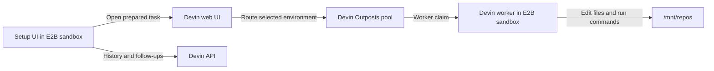

[Devin](https://devin.ai) is Cognition's coding agent. You can use E2B with
Devin in two ways:

- run Devin for Terminal directly inside an isolated E2B sandbox
- run a Devin Outposts worker in an E2B sandbox and route Devin sessions to it

## Run Devin for Terminal

[Devin for Terminal](https://devin.ai/terminal) runs directly from a terminal.
Install it in a sandbox to give Devin an isolated workspace without access to
your local machine.

```bash
e2b sandbox create base

###
# Inside the sandbox
###
curl -fsSL https://cli.devin.ai/install.sh | bash
source /home/user/.bashrc
```

After completing Devin's interactive sign-in, run a task from the project
directory:

```bash
git clone https://github.com/your-org/your-repo.git /home/user/repo
cd /home/user/repo

devin --permission-mode dangerous -p "Add error handling to all API endpoints"
```

## Run Devin Outposts in E2B

Use the public `devin-outposts` template to run an Outposts worker and its setup
UI inside an E2B sandbox. The template includes the Devin CLI, starts the setup
UI on port `3000`, and reserves `/mnt/repos` as the worker workspace.

<Card
  title="Open the Devin Outposts template"
  icon="terminal"
  href="https://e2b.dev/dashboard/terminal?template=aiengineer-d56d/devin-outposts"
>
  Start the template in the E2B dashboard and open its terminal.
</Card>

You can also start it with the SDK:

```ts
import { Sandbox } from "e2b"

const sandbox = await Sandbox.create("aiengineer-d56d/devin-outposts")
console.log(sandbox.sandboxId)
```

The immutable template ID is `myw11k4t1jtjbr7ckvz8`.

### Open the setup UI

When the terminal connects, it prints the exact setup URL for that sandbox and
the command that reads its sandbox-local control token. The URL has this shape:

```text
https://3000-<sandbox-id>.<e2b-domain>
```

The sandbox receives its runtime ID as `E2B_SANDBOX_ID`. A self-hosted E2B
deployment must configure its own E2B domain when building the template; the
sandbox cannot infer that public domain from its runtime ID.

Read the setup token inside the sandbox:

```bash
cat /home/user/.config/devin-outposts/control-token
```

Enter it in the setup UI. A successful exchange issues a signed, HTTP-only
session cookie valid for 12 hours. The control token remains reusable inside
that sandbox and is not stored in browser local storage.

### Configure the worker

The setup UI asks for credentials and routing information from your Devin
organization:

| Value | Purpose |
| --- | --- |
| Devin API key | List and message sessions after this worker claims them |
| Devin API URL | API endpoint for your Devin deployment |
| Devin web URL | Browser origin used to open the Devin task composer |
| Organization | Organization that owns the sessions |
| Outposts pool ID | Virtual environment the worker joins |
| Outposts worker token | Authenticates the worker to that pool |

<Warning>
  Do not put these credentials in a public template. The setup UI stores them
  only in the running sandbox with file mode `0600`. Treat a snapshot of a
  configured sandbox as secret-bearing.
</Warning>

Save the configuration and start the worker. The status view shows whether the
worker process is running and displays recent worker output for troubleshooting.
Confirm the pool appears in Devin's virtual-environment menu before sending a
task; process state alone does not prove pool registration.

### Send a task to the Outposts worker

1. Select **New task** in the setup UI. It opens Devin with a prepared prompt.
2. In Devin, open **Configuration**, then **Virtual environment**.
3. Select the Outposts environment that matches the configured pool.
4. Send the task.
5. Return to the setup UI and attach the session after the worker claims it.

The task prompt tells Devin to work in `/mnt/repos`. If Devin reports a
different workspace, such as `/home/ubuntu/repos`, the session is running on a
managed Devin machine instead of the selected Outposts environment.

The task is passed to Devin in the browser URL. Do not include credentials or
other secrets in the task field.

<Note>
  Creating a session through the public Devin v3 API does not currently select
  an Outposts pool. The initial task is therefore sent from Devin's web UI,
  where the virtual environment can be selected. After the worker claims the
  session, the template UI can display its history and send follow-up messages
  through the API.
</Note>

### Verify the worker

The worker log is the first place to check startup and claim failures:

```bash
devin --version
test -d /mnt/repos
tail -200 /home/user/devin-worker.log
```

Successful claim logs may contain either `serving session <session-id>` or a
structured `session_id` field. Once attached, the setup UI polls the session
history and renders Devin's messages as they become available.

### How the integration works



The worker, setup UI, credentials, and workspace stay inside the sandbox. The
browser talks to the setup UI, and the setup UI makes authenticated Devin API
requests on behalf of the user.

## Limitations

- A Devin API key does not start an Outposts worker. The worker also needs a
  pool ID and worker token.
- Existing Devin sessions remain assigned to the worker that claimed them. Do
  not assume a follow-up will migrate an old session to a replacement worker.
- Use scoped, short-lived Outposts worker tokens when available.
- Web apps started by Devin can be opened through their E2B sandbox preview
  URLs.
