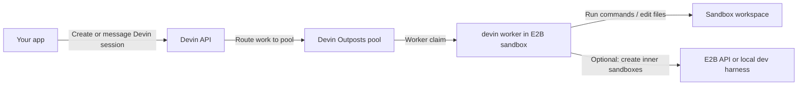

[Devin](https://devin.ai) is Cognition's coding agent. E2B can be used in two
ways with Devin:

- run Devin for Terminal directly inside an E2B sandbox
- run a Devin Outposts worker inside an E2B sandbox, so Devin can route work to
  an isolated runtime that can create and inspect other E2B sandboxes

<Note>
  The Outposts worker flow below is a rough integration pattern. It assumes you
  already have Devin API and Outposts credentials from Cognition.
</Note>

## Run Devin for Terminal inside a sandbox

[Devin for Terminal](https://devin.ai/terminal) works directly from a terminal.
You can install it in an E2B sandbox and use the sandbox as an isolated
workspace for agent tasks.

### Installation

Use a PTY for install and login because Devin's setup is interactive. You can create a Devin account during sign up if you don't have one.

```bash
e2b sandbox create base

###
# Inside the sandbox
###
curl -fsSL https://cli.devin.ai/install.sh | bash

source /home/user/.bashrc
```

### Usage

After installation and login, use `devin -p` for non-interactive mode and `--permission-mode dangerous` to auto-approve tool calls.

```bash
mkdir -p /home/user/project
cd /home/user/project

devin --permission-mode dangerous -p "Create a hello world HTTP server in Go"
```

### Example: work on a cloned repository

After installing Devin for Terminal and signing in, clone a repository and run Devin from the project directory.

```bash
git clone https://github.com/your-org/your-repo.git /home/user/repo
cd /home/user/repo

devin --permission-mode dangerous -p "Add error handling to all API endpoints"
```

Devin can edit files, run commands, and work on code inside the sandbox without accessing your local machine.

## Run a Devin Outposts worker in a sandbox

For development and higher-isolation workflows, you can run a Devin Outposts
worker inside an E2B sandbox. In this shape, the Devin session is created by
your app or by Devin, while the worker process runs in the sandbox and joins an
Outposts pool.



This lets you keep the agent runtime isolated from the developer machine while
still giving it command execution, filesystem access, preview URLs, and any
credentials you explicitly pass into the sandbox.

### Credentials

The Devin API key and the Outposts worker token are different credentials.

| Credential | Used by | Purpose |
| --- | --- | --- |
| Devin API key | Your backend or app | Create and message Devin sessions through the Devin API |
| Devin organization ID | Your backend or app | Select the Devin organization that owns the session |
| Outposts pool ID | Sandbox worker launcher | Select the pool the worker should join |
| Outposts worker token | `devin worker start` | Authenticate the worker to the pool |

Do not bake these credentials into a public template. Pass them as runtime
environment variables or use your own secret store.

If your backend proxies Devin API calls for a browser app, the Devin API key
should still be user-provided and user-scoped. The backend should not use one
shared Devin key for all users.

### Template

Build an E2B template that installs the Devin CLI and any project dependencies
the worker should have available.

```dockerfile
FROM e2bdev/base

RUN curl -fsSL https://cli.devin.ai/install.sh -o /tmp/devin-install.sh \
  && bash /tmp/devin-install.sh </dev/null || true \
  && test -x /home/user/.local/bin/devin \
  && sudo ln -sf /home/user/.local/bin/devin /usr/local/bin/devin \
  && rm -f /tmp/devin-install.sh

WORKDIR /mnt/repos
```

If your worker needs a long-running app or local control plane, add a readiness
script to the template and have the worker launcher wait for it before starting
Devin.

### Start the worker

Start a sandbox from the template, pass the Outposts credentials at runtime, and
start the worker in the sandbox.

```ts
import { Sandbox } from "e2b"

const sandbox = await Sandbox.create("devin-worker-template", {
  envs: {
    DEVIN_API_URL: "https://api.devin.ai",
    DEVIN_ACCEPTOR_ID: crypto.randomUUID(),
    DEVIN_OUTPOST_POOL_ID: process.env.DEVIN_OUTPOST_POOL_ID!,
    DEVIN_OUTPOSTS_TOKEN: process.env.DEVIN_OUTPOSTS_TOKEN!,
    DEVIN_REMOTE_STATE_DIR: "/home/user/.devin/worker/state",
  },
  lifecycle: {
    onTimeout: "pause",
    autoResume: true,
  },
})

await sandbox.commands.run(`
set -eu
export PATH="$HOME/.local/bin:/usr/local/bin:$PATH"
sudo install -d -o user -g user /mnt/repos "$DEVIN_REMOTE_STATE_DIR"
cd /mnt/repos
nohup devin worker start \
  --api-url="$DEVIN_API_URL" \
  --pool="$DEVIN_OUTPOST_POOL_ID" \
  --acceptor-id="$DEVIN_ACCEPTOR_ID" \
  >/home/user/devin-worker.log 2>&1 &
`)
```

The worker log is the first place to check startup failures:

```bash
tail -200 /home/user/devin-worker.log
```

### Create or message a Devin session

Use the Devin API with the user's Devin API key to create a session in the
organization that should use this worker pool.

```bash
curl --request POST \
  --url "https://api.devin.ai/v3/organizations/$DEVIN_ORG_ID/sessions" \
  --header "Authorization: Bearer $DEVIN_API_KEY" \
  --header "Content-Type: application/json" \
  --data '{
    "prompt": "Use the E2B sandbox worker to inspect the repository and run tests.",
    "title": "E2B sandbox worker test",
    "tags": ["e2b"]
  }'
```

Then configure the Devin workflow or Outposts setup so the session routes work
to the same pool the sandbox worker joined.

### Verify the worker sandbox

Use E2B command execution or a terminal connection to verify that the worker has
the expected runtime:

```bash
devin --version
test -d /mnt/repos
tail -200 /home/user/devin-worker.log
```

If the worker creates or runs a web app, expose the app on a sandbox port and
open the preview URL returned by E2B.

## Notes and limitations

- The Devin API key is not enough to start an Outposts worker. You also need a
  pool ID and worker token.
- Organization-scoped Devin API calls require a Devin organization ID.
- Keep worker tokens short-lived or scoped when possible.
- For browser-based tools, collect the Devin API key, organization ID, pool ID,
  and worker token from the user and store them only in user-scoped storage such
  as an encrypted session cookie or your application's secret store.
- This page intentionally keeps the E2B side generic. If you are running a
  local development control plane inside the sandbox, wait for its readiness
  script before starting the Devin worker.
